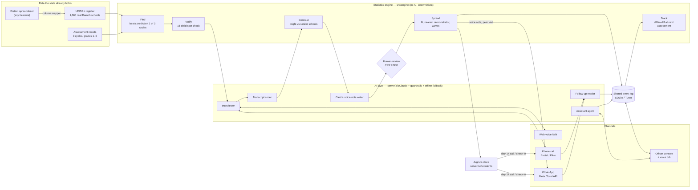

# Jugnu (जुगनू) — finds the fireflies

**The answer to a block's learning gap is often already in the block.**
AI for Foundational Learning Hackathon · Challenge 4 (Data to Action) · Build stage.

Dashboards tell a Block Education Officer (BEO) *where* learning is low. Jugnu finds the few
government schools where children read and count far better than their circumstances predict,
**talks to their teachers** in Hindi (a web voice call or an ordinary phone call) to learn exactly
what they do, keeps only what separates them from similar schools, spreads it **teacher to teacher**
as owned actions, and checks whether it worked.

---

## 1. Who uses it, what they put in, what they get back

Every role gives Jugnu input the way they already work (by voice, a phone call, a WhatsApp reply
or a spreadsheet they already have) and gets back one clear next step, not a dashboard to decode.

| Who | Where | What they put in | What they get back |
|---|---|---|---|
| **Teacher** (bright spot or comparison school) | `/talk` link on any Android phone, or an ordinary phone call | Speaks for about 12 minutes in Hindi or English about classroom routines. No app, no login, no typing | A thank-you, and a **coach** that answers "my children get stuck on matras" with a practice proven in *their own block*, a fellow teacher's own words, and the nearest school that does it |
| **Teacher** (struggling school) | WhatsApp or a phone call | Listens to a 60-second voice note; at day 14 answers "did you try it?" by voice note, text or call | The practice in a peer's voice; a peer visit; if something blocks them, the barrier goes to the person who can remove it |
| **CRP** (cluster resource person) | Console on a phone (`/today`, school pages) | A 15-child spot check, a classroom photo, a visit marked done or stuck | Which schools to check and in what order, distances and motorbike time, whether the photo shows the practice |
| **BEO** (block officer) | Console (`/today`), or simply asks Jugnu by voice | Questions in Hindi or English ("which schools are stuck?"), approvals of AI drafts, their own district spreadsheet | Owned actions (to do / scheduled / done / stuck), a plan board to export to Excel, calendar invites for peer visits, and a spoken briefing |
| **Judges** | `/ai` | — | Where AI is used, the live trace of every AI call, and the evaluation |
| **Testers** | `/testing` | Consented sessions, task comments, Hindi/English SUS | Results and the "you said → we changed" log |

**Designed for the constraints of a block:** voice first and Hindi first (the console has a Hindi
switch, and the assistant speaks and listens in both languages); basic phones reached by a real call;
the teacher page loads about 90 KB and keeps an unsent answer until the network returns; low-data mode
switches itself on for 2G/3G, data-saver or ≤ 2 GB RAM; light mode for sunlight. A first-visit
welcome, a spotlight guide over the real screens, "Your first 10 minutes" and "Play the term" (one
term replayed in about 40 s) teach the console without a manual.

---

## 2. How the solution comes together



### The components

| Component | What it does | How it connects | Code |
|---|---|---|---|
| **Statistics engine** | Find (robust regression on context: multigrade, size, attendance, home language, pupils per teacher), Verify (jump checks + binomial spot check), Contrast (Beta-Binomial), Spread (fit, nearest demonstrator by road, waves), Track (difference-in-differences, bootstrap intervals), plus contrast pairs and a what-if simulator | Runs identically in the browser and on the server, so every screen and every AI prompt sees the same numbers | `src/engine/` |
| **Guarded AI layer** | Ten Claude tasks, each in the same five layers: input → Claude (structured output, deadline) → deterministic guardrails → value, or the offline engine | Every call is traced in `ai_calls` and shown on `/ai` | `server/ai/run.ts`, `server/ai/guardrails.ts` |
| **Interview service** | Consent, the adaptive interview, turns, coding, erasure on request | Same service behind the web talk page and the phone call | `server/interviews.ts`, `src/pages/Talk.tsx` |
| **Voice** | Google Chirp 3 speech-to-text (with the block's school and teacher names as hints) and Chirp 3 HD voices | Used by the talk page, the phone audio bridge, WhatsApp voice notes and the assistant | `server/voice.ts` |
| **Phone line** | Real outbound calls; the provider streams audio over a WebSocket and Jugnu speaks and listens on it. A stream is admitted only for a call Jugnu is dialling | Exotel live; Plivo ready for an Indian number | `server/telephony.ts` |
| **WhatsApp** | Sends voice notes, check-ins and texts; reads replies (typed or voice) like a follow-up call; signed webhook; template outside the 24-hour window | Replies move the action board and escalate barriers | `server/whatsapp.ts` |
| **Jugnu's clock** | Reminders, visit checks, day-14 calls (WhatsApp if the phone line is off), escalation to the BEO | Ticks every minute on a long-running server, daily via Vercel Cron | `server/scheduler.ts` |
| **Shared event log** | One append-only log of everything people and Jugnu record: spot checks, visits, notes, action status | Every open screen updates within seconds; the activity feed reads it in plain words | `server/events.ts`, `server/db.ts` (SQLite or Turso) |
| **Human review queue** | AI drafts (practice cards, voice notes) reach teachers only after a CRP or BEO approves or edits them | Approval unlocks the voice note and WhatsApp sending | `server/reviews.ts`, `src/pages/Review.tsx` |
| **Officer console + assistant** | Today, schools, interviews, practices, plan, results, approvals, district map (Google 3D), Ask Jugnu; a voice orb that briefs, answers and works the console through tools | Reads the engine and the log; writes only through the log | `src/pages/`, `server/ai/agent.ts` |
| **Exports** | Plan board as CSV (Excel-ready, Hindi intact, live statuses) and calendar invites for peer visits | No new software for the block office | `server/exports.ts` |

### One practice, end to end

1. **Find.** Tendukheda's register and three assessment cycles go in; the engine predicts each school's
   reading score from its context and flags the schools that beat it in 2 of 3 cycles.
2. **Verify.** The CRP does a 15-child spot check; a score that does not hold up leads to a respectful
   revisit, never a penalty.
3. **Listen.** Jugnu calls the bright-spot teacher (and teachers in similar ordinary schools). The
   interviewer asks for concrete routines, follows up when an answer is vague, and mirrors the
   teacher's Hindi or English.
4. **Contrast.** The coder maps code-mixed answers to practices with verbatim quotes; the engine keeps
   only practices common in bright spots and rare in similar schools (for example, grouping children
   by reading level for part of the day).
5. **Spread.** Claude drafts a practice card and a 60-second voice note in the demonstrator's words; a
   CRP approves it; the struggling school two villages away gets the voice note on WhatsApp and a peer
   visit with a calendar invite.
6. **Follow up.** At day 14 Jugnu calls or asks on WhatsApp; the reader classifies the answer as
   adopted, trying, barrier or not tried. A barrier gets an owner and escalates to the BEO.
7. **Track.** At the next assessment, wave 1 against wave 2 shows whether it transferred.

---

## 3. Where AI is used (read the code here)

```
input ──► Claude (structured output, deadline) ──► deterministic guardrails ──► value
                     │ unavailable / slow / declined / fails a check
                     └──────────────► offline engine ──────────────────────► value
every call ──► ai_calls trace (task, model, latency, tokens, each check passed/failed)
```

| Task | File | What Claude does | Guardrails | Offline fallback |
|---|---|---|---|---|
| Adaptive interviewer | `server/ai/interviewer.ts` | next question; follows up on vague answers; mirrors the teacher's language | classroom routines only · ≤ 40 words · right language · never repeats · can't close early | scripted interviewer |
| Transcript coding | `server/ai/coder.ts` | maps code-mixed answers to the practice taxonomy; proposes new practices | quote must be **verbatim** · specificity counted only from the quote | keyword lexicon |
| Practice card | `server/ai/writer.ts` | 3–5 steps from teachers' own quotes | every step cites a quote · **no invented numbers** · Hindi · then **human review** | card built from quotes |
| Peer voice note | `server/ai/writer.ts` | 60-second spoken note in the demonstrator's words | keeps every number · invents none · ≤ 170 words · then **human review** | the draft |
| Follow-up reader | `server/ai/followup.ts` | adopted / trying / barrier / not tried, and who can remove the barrier (calls and WhatsApp replies) | evidence quote verbatim · barrier has an owner | keyword rules |
| Officer Q&A agent | `server/ai/officer.ts` | answers by calling read-only tools over the block (incl. contrast pairs and what-if) | must look data up · school names checked | rule-based answers |
| Jugnu assistant | `server/ai/agent.ts` | voice/chat agent that briefs and works the console; write tools move actions, schedule follow-ups, escalate, dial, send WhatsApp | writes only through the event log, marked "Jugnu AI" · numbers only as given by the officer | console works by hand |
| Photo check | `server/ai/vision.ts` | is the practice visible in the CRP's photo | never identifies people · flags children's faces · photo never stored | CRP's judgement stands |
| Teacher coach | `server/ai/coach.ts` | answers a teacher's problem with a practice proven in their block | practice must be distinctive here · quote verbatim · teacher's language | keyword match |
| Column mapper | `server/ai/mapper.ts` | maps a district's own spreadsheet headers onto Jugnu's columns | every column exists · none used twice · scales plausible | synonym table |

Claude does what language models are good at (conversation, meaning in code-mixed Hindi, writing from
evidence, tool use). Statistics does the counting. Models: Claude Haiku 5.5 for the structured tasks,
Claude Sonnet 5.5 for the assistant. Speech is Google Chirp 3.

---

## 4. Evaluation and testing

```bash
npm test        # 52 tests: engine on simulated blocks, guardrails, interview service (SQLite + Turso), telephony, WhatsApp, coach, exports, mapper
npm run eval    # coding vs 30 hand-labelled answers + guardrails under attack + interviewer behaviour
npm run smoke   # end-to-end interview against a running server (consent → 7 topics → coding)
node scripts/flows.mjs http://localhost:8788   # every user flow against a running server
```

`npm run eval` attacks every guardrail with deliberately bad outputs (fabricated quotes, changed or
dropped numbers, caste/religion/politics/pay/personal questions, wrong language, invented school
names, phone/ID numbers) and counts false alarms on good outputs. With a Claude key it also scores
the Claude coder against the keyword coder.

**Field testing:** `/testing` records consented sessions with teachers, CRPs and BEOs (role tasks,
think-aloud comments, a Hindi/English SUS) and the "you said → we changed" log.
`docs/TESTING-KIT.md` explains how to run a session.

---

## 5. Works in real conditions

- **Real calls:** Jugnu dials through Exotel (Plivo when an Indian number is added) and runs the
  interview over the provider's audio stream. Phone numbers are stored only as a salted hash.
- **Claude down or slow:** every task degrades to the offline engine; on the phone Claude gets 8 s
  per turn so the caller never waits.
- **Low connectivity and cheap phones:** see §1. The app shell is cached by a service worker.
- **Real data:** works on a district's own spreadsheet (Data & method → Import CSV), with the column
  mapper handling UDISE+ exports and Hindi headers.

## 6. Privacy and safety

Adults only, with spoken consent; a "no" deletes the conversation. Phone numbers are stored only as a
salted hash; phone/ID numbers are scrubbed from transcripts; transcripts can be erased on request. No
child-level data (school aggregates and an anonymous 15-child spot check). No public ranking;
suspected inflation leads to a respectful revisit, never a penalty. AI drafts reach teachers only
after a CRP or BEO approves them. The interviewer never asks about caste, religion, politics, pay,
transfers or personal life. Spot-check photos are never stored.

## 7. Data: what is real and what is simulated

- **Real:** Damoh district (Madhya Pradesh), its 7 blocks and their UDISE+ 2025-26 profiles; **1,365
  real government schools** from the UDISE+ register (code, name, Hindi name, location, cluster,
  class 1–5 enrolment, teacher count); OpenStreetMap outlines and villages; ASER 2024 national
  figures for calibration. Interviews and anything people record in the console are real.
- **Simulated, and labelled in the app:** school-level learning results, attendance by cycle,
  library use, home-language mismatch, teachers' and CRPs' names, classroom practices. No public
  source publishes these. The simulator plants bright spots, inflated schools and decoy practices so
  every step can be scored against a known truth.

## 8. Roadmap and integration

| When | What | Integrates with |
|---|---|---|
| Pilot (one block, one term) | Run the loop in Tendukheda with real assessment results; 5–8 field sessions per role; tune questions and voice notes | State assessment exports and UDISE+ via the column mapper; WhatsApp and IVR the block already uses |
| District | All 7 Damoh blocks; DIET faculty review AI drafts alongside CRPs | District EMIS; the BEO's existing review meetings (plan board CSV, calendar invites) |
| State | Bright-spot practices pooled across districts, with evidence by context (tribal, multigrade, language) | State command centres (VSK) as a data source and a destination for owned actions |
| Speech | Sarvam / Bhashini as an alternative speech engine for more Indian languages | `transcribe()` / `synthesize()` in `server/voice.ts` — one swap point |
| Calls at scale | Exotel production account (KYC), Plivo India number, a fixed public endpoint | `server/telephony.ts` already speaks both providers |

---

## Run it

```bash
npm install
cp .env.example .env      # add ANTHROPIC_API_KEY to switch on Claude; everything works without it
npm run dev               # web http://localhost:5190, API :8788
npm run build && npm start   # production: one server on $PORT serving the app and the API
```

Optional settings are documented in `.env.example`: `DEMO_PASSCODE` (officer console),
`GOOGLE_CLOUD_API_KEY` (Chirp speech), `EXOTEL_*` / `PLIVO_*` + `PUBLIC_URL` (real phone line; the
provider needs a public WebSocket, so run the API on a long-lived host or a tunnel), `WHATSAPP_*`
(Meta Cloud API), `CRON_SECRET`, `TURSO_*` / `JUGNU_DB` (storage). There is no phone simulator.

### Deploy

- **Vercel (free):** `npm run deploy:vercel` builds the web app as static files and the API as one
  Node function in Mumbai (`bom1`), with data in **Turso**. Vercel functions cannot carry phone audio.
- **Any long-running Node host:** `npm run build && npm start`, with `JUGNU_DB` on a persistent
  volume (health check `/api/status`). This host can also carry phone calls.

## Repository

```
server/            Express API (app.ts), storage (db.ts), interviews, phone line, WhatsApp, scheduler, reviews, exports, testing
server/ai/         run.ts (the five layers) · guardrails · interviewer · coder · writer · followup · officer · agent · vision · coach · mapper
src/engine/        Find / Verify / Contrast / Spread / Track statistics, insights, the real Damoh schools and the simulator
src/pages/         Home · Talk (teacher) · Today · Schools · School · Ask · Practices · Plan · Results · Review · District · Testing · AI · Method · About
scripts/           eval.ts · smoke.mjs · flows.mjs · credits.ts
data/eval/         hand-labelled coding set and the latest evaluation results
docs/TESTING-KIT.md   how to run field sessions and record "you said → we changed"
```

Built with Claude (Anthropic). Film made with Google Veo 3.1, Lyria and Chirp 3 HD.
